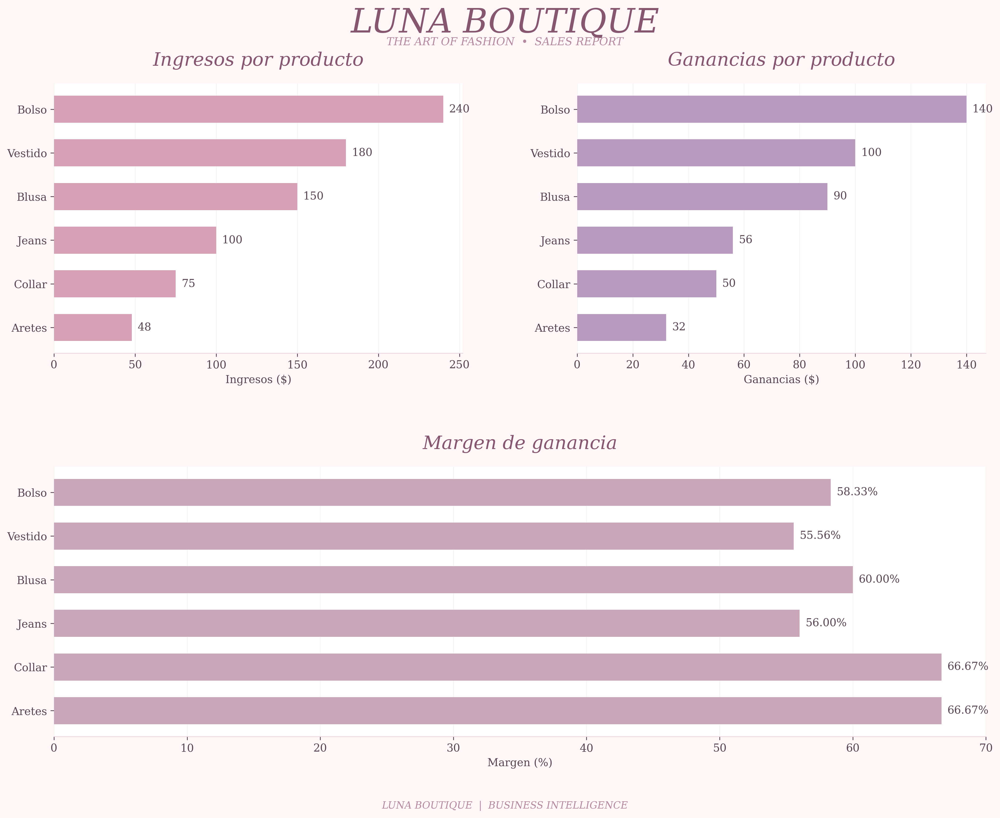

# 🌙 LUNA BOUTIQUE

### DATA ANALYSIS PROJECT

*Turning data into business decisions.*

---

**SALES PERFORMANCE · PROFITABILITY · BUSINESS STRATEGY**

## 🎀 About the Project

This project analyzes the commercial performance of Luna Boutique, a fashion business, to identify its most profitable products and discover opportunities for business growth.

## 🎯 Project Objective

Evaluate revenue, total profit, and profit margins to identify high-performing products and develop data-driven marketing recommendations.

## 📊 Analysis

- Revenue by product
- Total profit by product
- Profit margin comparison
- Marketing strategy recommendations

## 🛠️ Tools & Technologies

- Python
- Pandas
- Matplotlib
- Google Colab

## 💡 Key Business Insights

The analysis explores how sales volume, revenue, and profitability can influence business decisions and marketing investment.

## ✨ Recommendations

Develop targeted marketing strategies based on product performance, profitability, and customer demand.

---

*LUNA BOUTIQUE | BUSINESS INTELLIGENCE*

## 💡 Business Recommendations

- **Bags:** Prioritize marketing investment, particularly on Instagram, due to their highest contribution to total profit.
- **Earrings:** Maintain current pricing and leverage their high profit margin through targeted promotional strategies.
- **Necklaces:** Maintain current pricing and explore complementary product opportunities to increase sales.
- **Marketing Performance:** Track advertising costs, clicks, add-to-cart events, conversions, and net profit to evaluate campaign effectiveness.

**Strategic Goal:** Maximize overall business profitability through data-driven marketing and pricing decisions.

importance of evaluating both total profit and profit margins when making business decisions.

Bags generated the highest total profit, while earrings and necklaces achieved the highest profit margins. These findings suggest that marketing strategies should consider both revenue contribution and product profitability.

By using data-driven decisions, Luna Boutique can improve its marketing investment, optimize product performance, and identify opportunities for sustainable business growth.

Final Objective: Turn business data into actionable insights that support better decisions and increase overall profitability.
